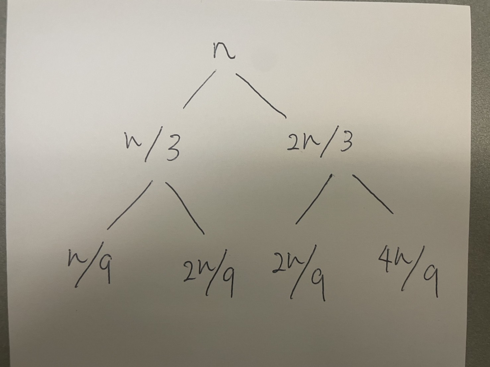

# Lab 09: Exploring D&C Algorithms

**Instructions:** Work in small groups to complete the following exercises. Try sketching out your work on the whiteboards or scratch paper. Everyone should submit their own answers to the exercises, but you are encouraged to discuss your reasoning with your group members.

Name(s): Issei Hasegawa

---

## Exercise 1: Recurrence Extraction

Consider the following divide-and-conquer algorithm, which takes an array $A$ of $n$ numbers as input and returns a single number. 

```text
Procedure Mystery(A, n)
    if n <= 1:
        return A[1]                              // Base case
        
    k = floor(n / 3)                             // Find the one-third point
    
    left = Mystery(A[1..k], k)                   // Recur on the left third
    right = Mystery(A[k+1..n], n - k)            // Recur on the rest
    
    total = 0 
    for i = 1 to n:
        total = total + (A[i] * left * right)    // Combine results
        
    return total
```

### Part A: The Recurrence Relation
Let $T(n)$ be the running time of `Mystery` on an input of size $n$. Write down a recurrence relation for the worst-case running time $T(n)$. You may assume $n$ is a power of 3 for simplicity. *(Note: You do not need to solve the recurrence relation yet, just formulate it).*

Ignoring rounding, the intended recurrence is

$$T(n) = T\left(\frac{n}{3}\right) + T\left(\frac{2n}{3}\right) + \Theta(n),$$

with constant-time base cases, including $T(1) = \Theta(1)$.

The two recursive calls process subarrays of sizes approximately $n/3$ and $2n/3$. The combine loop runs $n$ times and performs constant-time work in each iteration, so its total cost is $\Theta(n)$. The remaining nonrecursive operations take constant time.

### Part B: Visualizing Algorithm Behavior
Without solving the recurrence, look closely at the recursive calls and the combine step. If you were to draw the recursion tree for this algorithm, what would it look like? Is the tree balanced or skewed? 

The recursion tree is a binary tree because each non-base-case call makes two recursive calls. Ignoring rounding, the first few levels have the following subproblem sizes:



The tree is skewed toward the larger, right-hand subproblems rather than evenly balanced. Following a left branch reduces the input size to one third, while following a right branch reduces it to two thirds. Therefore, paths that repeatedly take the right branch require more recursive calls to reach a base case, so the leaves occur at different depths. At each node with input size $m$, the combine loop performs $\Theta(m)$ work.

---

## Exercise 2: Unrolling the Recursion Tree

Suppose you have developed a new divide-and-conquer algorithm. You analyze your pseudocode and determine that its worst-case running time $T(n)$ satisfies the following recurrence relation:

$$T(n) \leq 3T\left(\frac{n}{2}\right) + cn^2 \quad \text{for } n > 1$$
$$T(1) \leq c$$

where $c$ is a positive constant. 

### Part C: Recursion Tree Analysis

Analyze the running time of the algorithm by unrolling the recursion tree. Specifically, answer the following questions:

1. **Root Work:** Find the amount of work done at the root level (level $0$) of the recursion tree.

   The root contains one problem of size $n$, so its nonrecursive work is at most

   $$W_0 \leq cn^2.$$

2. **First Levels:** Find the amount of work done at level $1$ and level $2$ of the recursion tree.

   At level $1$, there are $3$ subproblems, each of size $n/2$. The total nonrecursive work at this level is at most

   $$W_1 \leq 3c\left(\frac{n}{2}\right)^2 = \frac{3}{4}cn^2.$$

   At level $2$, there are $3^2 = 9$ subproblems, each of size $n/4$. The total nonrecursive work at this level is at most

   $$W_2 \leq 9c\left(\frac{n}{4}\right)^2 = \frac{9}{16}cn^2.$$

3. **Tree Height:** Find the height of the recursion tree (at what level does the input size reach $1$?).

   Assume $n$ is a power of $2$ so that the divisions are exact. At level $h$, each subproblem has size $n/2^h$. The base case is reached when

   $$\frac{n}{2^h} = 1 \quad \Longrightarrow \quad h = \log_2 n.$$

   Therefore, the tree has height $\log_2 n$ and $\log_2 n + 1$ levels, counting the root as level $0$.

**Bonus!** Find a general formula for the total work done at level $i$ of the recursion tree.

At level $i$, there are $3^i$ subproblems, each of size $n/2^i$. Thus, the total work at that level is bounded by

$$W_i \leq 3^i c\left(\frac{n}{2^i}\right)^2 = cn^2\left(\frac{3}{4}\right)^i, \qquad 0 \leq i \leq \log_2 n.$$

Each successive level's work bound is $3/4$ of the previous level's bound. At the leaf level, each subproblem has size $1$ and costs at most $c$, so the same formula applies. These are upper bounds because the given recurrence uses $\leq$.

---

## Exercise 3: Reflection

1. During lecture last week, we looked at two different divide-and-conquer algorithms. What were these algorithms and what problems did they solve?

   The two algorithms were **merge sort** and the **2D nearest-neighbors (closest-pair) algorithm**.

   Merge sort solves the sorting problem: it puts the elements of an array in order. It divides the array into two roughly equal halves, recursively sorts each half, and merges the sorted halves.

   The nearest-neighbors algorithm finds the pair of points with the smallest distance among $n$ points in the plane. It splits the points into two roughly equal halves, recursively finds the closest pair in each half, and checks a narrow strip near the dividing line for a closer pair that crosses the split.

2. How do the algorithms you analyzed in this lab compare to the ones we discussed in lecture? Specifically, each algorithm differs from the two we discussed in lecture in one important way. For each of the algorithms above, what is that difference?

   Both lecture algorithms make two recursive calls on roughly equal halves and combine their results in linear time.

   In **Exercise 1**, the main difference is the unequal split: the subproblem sizes are approximately $n/3$ and $2n/3$, instead of $n/2$ and $n/2$. There are still two recursive calls and a linear-time combine step, but some paths in the recursion tree are deeper than others.

   In **Exercise 2**, the recurrence has **three** recursive calls of size $n/2$, instead of two. It also uses a quadratic nonrecursive-work bound, $cn^2$, instead of a linear bound. Thus, both the number of recursive calls and the nonrecursive-work term differ from the lecture examples.
